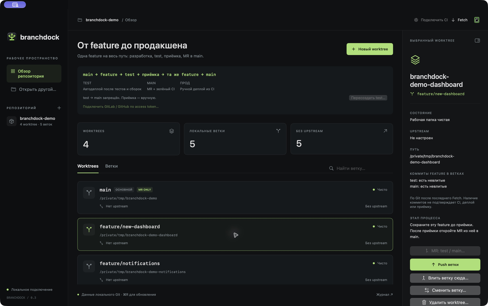
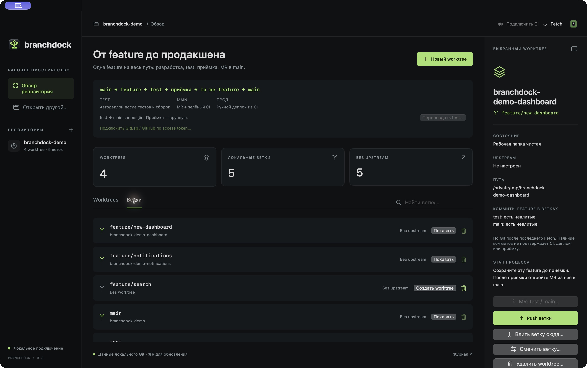

# BranchDock

Нативное macOS-приложение для управления локальными Git worktree и ветками. Основной экран показывает связь «рабочая папка → ветка → upstream», а не diff файлов.

## Скриншоты

Реальный интерфейс приложения на демонстрационном репозитории с вымышленными ветками и локальными worktree.

### Рабочее пространство



### Локальные ветки



## Быстрый старт: сборка из исходников

Нужны **macOS 14 Sonoma или новее**, **Swift 5.9+** (Xcode или Xcode Command Line Tools) и Git. Сторонних Swift-пакетов нет.

1. Установите инструменты разработчика, если они ещё не установлены:

   ```sh
   xcode-select --install
   ```

2. Клонируйте проект и перейдите в его папку:

   ```sh
   git clone https://github.com/piksel-man231/BranchDock.git
   cd BranchDock
   ```

3. Проверьте инструменты и запустите тесты:

   ```sh
   swift --version
   /usr/bin/git --version
   swift test
   ```

4. Соберите и установите приложение:

   ```sh
   ./build-app.sh
   open /Applications/BranchDock.app
   ```

Скрипт собирает release-версию, создаёт `dist/BranchDock.app`, подписывает её локальной ad-hoc подписью и устанавливает в `/Applications`. При повторном запуске он заменяет ранее установленную версию. Для установки нужны права записи в `/Applications`.

Для сборки без установки в `/Applications`:

```sh
swift build -c release
.build/release/BranchDock
```

Для запуска из исходников во время разработки:

```sh
swift run BranchDock
```

Полный Xcode-проект не требуется: проект использует Swift Package Manager. При необходимости откройте `Package.swift` в Xcode и выберите схему `BranchDock` для запуска на Mac.

## Запуск

После сборки установленное приложение находится в `/Applications/BranchDock.app`. Копия сборки: `dist/BranchDock.app`. Откройте её в Finder или выполните из папки проекта:

```sh
open /Applications/BranchDock.app
```

Выберите папку репозитория через **⌘O**. Подойдёт как основная папка, так и связанный worktree. Приложение запоминает последний открытый репозиторий.

## Процесс выпуска

`main → feature → test → приёмка → та же feature → main → ручной деплой прода`

- Новая ветка по умолчанию создаётся от локальной `main`. Перед началом задачи обновите main из remote.
- Опубликуйте feature через **Push ветки**, затем откройте **MR: test / main… → test**. Можно также влить feature в локальный worktree `test` и опубликовать `test`.
- На сервере `test` автоматически выкатывается после всех тестов и сборок. Проведите приёмку; сохраняйте исходную feature.
- После приёмки откройте **MR: test / main… → main** из той же feature. В форме приложения подтвердите приёмку. Зелёный CI и условия слияния проверяются на сервере.
- Прямые merge и push в `main` заблокированы приложением, включая `test → main`. Защита ветки и требование зелёного CI должны быть настроены в GitLab отдельно.
- После слияния в `main` прод запускается кнопкой **Деплой** у ручной job в инспекторе CI приложения или вручную в GitLab.

Форма MR поддерживает GitLab, включая свои серверы, с HTTPS и SSH remote. Она открывает браузер с заполненными исходной и целевой ветками, без автоматического создания или слияния MR. Удаление исходной feature в MR в test должно быть выключено. Если remote не подходит, создайте MR вручную.

В инспекторе feature отображается, присутствуют ли все её коммиты в `test` и `main`. Используются remote-tracking refs `origin` (или первого remote); без remote — локальные ветки. **Fetch** обновляет эти данные. Это проверка истории Git, а не статуса CI, приёмки или деплоя. При squash/rebase Git может не распознать включение исходных коммитов: для удаления такой feature включите «Удалить ветку, даже если Git считает её неслитой».

### Пересоздание test

**Пересоздать test…** запрашивает текущие `main` и `test` на выбранном remote и показывает точные коммиты перед подтверждением. При выполнении прежний `test` архивируется в `archive/test-<UUID>`, а `test` заменяется проверенным снимком `main`. Оба изменения отправляются одним atomic push с явными `force-with-lease` для `test` и архива. Повторная проверка remote останавливает операцию, если `test` изменился после предпросмотра; lease защищает от перезаписи конкурентного push. При коллизии архива или отсутствии поддержки atomic push сервер отклоняет операцию целиком.

Локальные ветки и worktree не сбрасываются; после операции выполните Fetch. Пересоздание может запустить серверный CI и тестовый деплой. Пересоздание test не меняет конфигурацию CI и не запускает ручные jobs прода.

## Интеграция с GitLab и GitHub CI

Нажмите **Подключить CI** в верхней панели. Выберите remote и сервис, проверьте адрес API и путь проекта, введите access token и нажмите **Проверить и сохранить**. Настройки привязаны к открытому репозиторию и общие для его worktree. Адрес и проект подставляются из HTTPS/SSH remote; для своего GitLab и GitHub Enterprise их можно изменить вручную. API должен быть доступен по HTTPS с доверенным сертификатом.

Необходимые права:

- **GitLab:** `read_api` и доступ к проекту ([документация](https://docs.gitlab.com/security/tokens/access_token_scopes/)).
- **GitHub:** fine-grained token с доступом к выбранному репозиторию, **Actions: Read** и **Contents: Read**. Для classic PAT приватного репозитория нужен `repo` ([Actions API](https://docs.github.com/en/rest/actions/workflow-runs), [Branches API](https://docs.github.com/en/rest/branches/branches)). Для организации может понадобиться разрешение SSO или одобрение токена.

На схеме процесса появляются статусы `main`, `test` и выбранной ветки. Обновление — при открытии репозитория, смене worktree, раз в минуту и по кнопке рядом со статусами. Это отдельное обновление API; **Fetch** обновляет локальные ссылки Git.

Статус запрашивается для **текущего HEAD ветки на сервере**. Если локальный HEAD отличается, инспектор предупреждает об этом. Если для HEAD ещё нет CI, отображается «Нет запусков для HEAD», даже если предыдущий коммит был зелёным. Ошибка сети или доступа убирает прежний зелёный статус и показывает причину.

- **GitLab:** последний пайплайн для текущего коммита ветки и его jobs со стадиями и ссылками. Ручные jobs, например продовый deploy, видны отдельно даже при успешном общем статусе. Дочерние пайплайны отдельно не обходятся.
- **GitHub Actions:** последние запуски каждого workflow и события для HEAD, с общим результатом и ссылками. Ошибка одного workflow не скрывается успешным запуском другого. Внешние checks, branch protection и CI для отдельного merge-коммита PR сюда не входят.

Для ручных jobs GitLab в инспекторе есть кнопка **Деплой** (если имя job или стадия содержит `deploy`) или **Запустить**. Перед запуском показываются проект, ветка, SHA и job; после подтверждения приложение перепроверяет HEAD и ручное состояние job и отправляет `POST /projects/:id/jobs/:job_id/play`. Запускается конкретная job существующего пайплайна, а не новый пайплайн. После запроса статус обновляется; повторные клики во время запроса заблокированы. При ошибке сети сначала обновите CI: сервер мог принять запрос. Для запуска нужен токен с правом **api**, роль с разрешением запускать job и доступ к защищённой ветке/окружению. Токен с **read_api** подходит только для просмотра; замените его в настройках CI. GitHub Actions по-прежнему доступны для просмотра. Дочерние пайплайны и jobs с обязательными ручными переменными запускайте в GitLab.

Статус CI читается через GET, запуск выбранной ручной job GitLab — через POST. Токен хранится только в **macOS Keychain**, отдельно от метаданных подключения. Он передаётся в заголовке HTTPS, не попадает в URL, UserDefaults или журнал операций. Перенаправления API не выполняются с токеном: при перенаправлении укажите конечный адрес API. Ответы API не сохраняются в дисковом кэше. **Настройки CI → Отключить** удаляет сохранённый токен и настройки этого подключения; сам токен у провайдера при этом не отзывается.

Можно заменить токен через настройки CI. Если адрес API, сервис или проект изменены, требуется ввести токен заново. При сохранении прежнего подключения пустое поле оставляет сохранённый токен.

## Возможности

- Worktree и локальные ветки с путями, upstream, ahead/behind и состоянием merge.
- Создание worktree с новой или существующей свободной веткой; переключение веток.
- Merge в выбранный worktree, кроме main: предпросмотр направления и числа входящих коммитов, затем подтверждение.
- Push в одноимённую ветку remote с настройкой upstream, кроме main. Обычная публикация выполняется без force.
- Обнаружение незавершённого merge, отмена merge, журнал последней операции.
- Удаление worktree с папкой и файлами; отдельно — удаление локальной ветки.
- Открытие в Finder, копирование пути и запуск Terminal.

Merge и переключение блокируются при незакоммиченных изменениях. Конфликты разрешаются во внешнем редакторе. Отмена merge вызывает `git merge --abort`. Перед push заново проверяется текущая ветка и отсутствие незавершённого merge.

Терминальная интерактивная аутентификация отключена: используйте настроенный credential helper или SSH agent. Для Git используется credential helper или SSH agent; access token интеграции CI хранится отдельно в macOS Keychain.

Удаление worktree физически удаляет папку без Корзины. Для удаления локальных изменений, неотслеживаемых или игнорируемых файлов (например `.env`) нужно отдельное разрешение. Основной и заблокированные worktree защищены.

Ветки `main` и `test` удалить нельзя. Без принудительного удаления feature с коммитами вне `main` сохраняется. Если при удалении worktree выбрано также удаление такой feature, операция останавливается до удаления папки. Галочка «Удалить ветку, даже если Git считает её неслитой» разрешает удаление feature без слияния в `main`, в том числе вместе с worktree; уникальные коммиты могут быть потеряны. Сам worktree можно удалить, сохранив ветку. После MR в main выполните Fetch. Ветки на remote не удаляются.

## Сборка и проверка

Требования: macOS 14+, Swift 5.9+ / Xcode Command Line Tools, Git в `/usr/bin/git`. Зависимостей от сторонних пакетов нет.

```sh
./build-app.sh
swift test
```

Скрипт создаёт локально подписанный `.app` в `dist/` и сразу устанавливает новую версию в `/Applications/BranchDock.app`. Перед заменой установленной версии проверяется подпись подготовленной копии. Иконка собирается, если есть `Assets/BranchDock.png`; без неё приложение использует стандартную иконку. Для распространения на других Mac понадобятся Developer ID и notarization.

Интеграционные тесты создают временные репозитории и локальные bare remote. Проверяются worktree, merge в test, конфликты и abort, push feature, устаревшее состояние ветки, удаление файлов и защита веток, запреты merge/push в main, URL формы MR, архивирование test, конкурентные изменения remote, коллизия архива и отказ сервера без atomic push. Реальные репозитории пользователя тесты не меняют.

Тесты CI используют поддельный HTTP-транспорт и отдельное хранилище токенов в памяти: проверяют авторизацию, кодирование URL, сопоставление с SHA, ручные jobs, несколько workflows, пагинацию, ошибки API, отдельное хранение токена и отключение. Реальные access tokens, Keychain пользователя и внешние API тесты не затрагивают.
